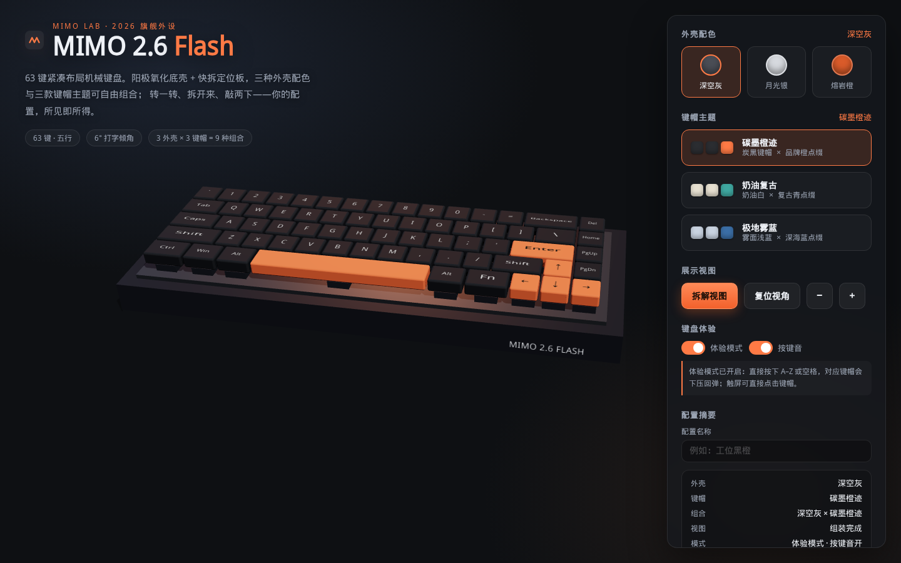

# MIMO 2.6 Flash — 紧凑机械键盘 · 交互式 3D 产品展示与配置

一把原创紧凑机械键盘（MIMO 2.6 Flash）的交互式产品页：用 **Three.js** 渲染完整 3D 键盘，配置界面全部是**普通 HTML/CSS 控件**（不把页面画进 Canvas）。无后端，纯前端。



## 功能一览

- **首屏即产品**：产品名称、简介、完整 3D 键盘与主要配置控件同屏呈现。
- **67 键紧凑配列**：五行布局，含完整字母区、数字行、方向键，以及 2u 退格、2.25u 回车、2.25u/1.75u 左右 Shift、6.25u 空格等不同宽度的大键。
- **真实产品结构**：楔形底壳（前低后高约 6° 打字倾角、橡胶脚垫、USB-C 口、金属铭牌）→ 带 67 颗轴体的定位板 → 带锥度与可读字符的键帽，三层分明，不是漂浮的方块阵列。
- **3 外壳配色 × 3 键帽主题 = 9 种组合**：任意搭配，3D 预览与右侧配置摘要实时同步。
- **拆解 / 组装**：键帽、定位板、底壳三层之间平滑展开/复原；快速反复点击也只会收敛到正确目标状态。
- **键盘体验模式**：按下物理键盘 A–Z 或空格，对应键帽弹簧式下压回弹（带合成按键音）；触屏/鼠标可直接点击键帽；输入框获得焦点时不劫持正常输入。
- **本地配置**：配色、主题、配置名、开关状态自动保存到 `localStorage`（仅本页面自己的存储键），刷新后恢复；「恢复默认」只清除此页面自己的配置，不触碰其它来源的数据。
- **视角操作**：拖拽整体旋转、滚轮/按钮缩放、一键复位（带缓动）。

## 快速开始

```bash
npm install        # 安装依赖（three + vite）
npm run dev        # 开发服务器，默认 http://localhost:5173
npm run build      # 生产构建 → dist/index.html（JS/CSS 已内联）
npm run preview    # 本地预览构建产物
```

### 单文件交付版

```bash
npm run build:single
```

会在仓库根目录额外生成 **`MIMO2.6-Flash.html`** —— 一个完全自包含的单文件版本（Three.js、样式、逻辑全部内联，无任何外部引用），双击即可在浏览器打开，也可直接分发。

## 使用说明

| 操作 | 方式 |
| --- | --- |
| 旋转视角 | 在 3D 区域按住拖拽 |
| 缩放 | 滚轮，或面板中的 `−` / `＋` 按钮 |
| 复位视角 | 「复位视角」按钮 |
| 拆解 / 组装 | 「拆解视图 / 组装还原」按钮 |
| 体验打字 | 开启「体验模式」后直接按 A–Z / 空格；触屏可点击键帽 |
| 保存配置 | 修改即自动保存；也可点「保存配置」显式保存并提示 |
| 恢复默认 | 「恢复默认」——仅清除本页面自己的配置 |

## 技术说明

- **技术栈**：原生 ES Module + Vite + three.js（`OrbitControls`、`RoundedBoxGeometry`），无 UI 框架、无后端。
- **模块结构**：
  - `src/layout.js` — 67 键配列数据（键宽、坐标、事件码）
  - `src/keyboardModel.js` — 三层 3D 模型构建、换色/换主题接口
  - `src/scene.js` — 渲染器、灯光、相机、轨道控制、拆解与按压动画（弹簧积分）、点击拾取
  - `src/input.js` — 物理键盘 → 键帽联动（不劫持输入控件）
  - `src/sound.js` — WebAudio 实时合成按键音（无音频资源文件）
  - `src/config.js` / `src/store.js` — 主题定义与状态 + `localStorage` 持久化（键名 `mimo26-flash.config.v1`）
  - `src/ui.js` — 配置面板与摘要渲染
  - `src/main.js` — 装配入口
- **动画健壮性**：拆解与按压均采用「目标值 + 每帧收敛」的写法（指数趋近 / 弹簧积分），不依赖一次性补间，因此快速反复触发不会错位。

## 已执行的验证（如实记录）

在本仓库中执行过 `npm run build` 与 `npm run build:single`，均成功。另用 Playwright + Headless Chromium 对构建产物跑了端到端脚本 `scripts/verify.mjs`，结果：

- 首屏要素齐全（产品名 / 简介 / Canvas / 配置面板同屏），67 枚键帽全部生成；
- 切换配色与键帽主题后，摘要文案同步更新（如「月光银 × 奶油复古」）；
- 拆解视图三层正常展开；快速连点 5 次后键帽层 y 偏移收敛回 0（组装位）；
- 体验模式按 `A` 键帽下压、松开回弹；输入框聚焦时按 `S` 不触发键帽且字符正常进入输入框；
- 保存后刷新，配色与配置名（「熔岩橙 × 极地雾蓝」「工位黑橙」）正确恢复；
- 「恢复默认」后本页配置键被清除，而同域其它存储键完好；
- 控制台无错误。

复现验证（可选，需联网安装一次 Playwright）：

```bash
npm i -D playwright && npx playwright install chromium
npm run verify     # 需先 npm run build
```

截图见 `.verify/` 目录。未在真实触屏设备与其它浏览器（Firefox/Safari）上实测，也未做过移动端真机验证；窄屏布局仅按响应式规则实现。

## 说明

- 产品为原创虚构设计，键位配列为通用紧凑布局，不复刻任何具体品牌型号。
- 声音为 WebAudio 实时合成，可在面板中关闭。
